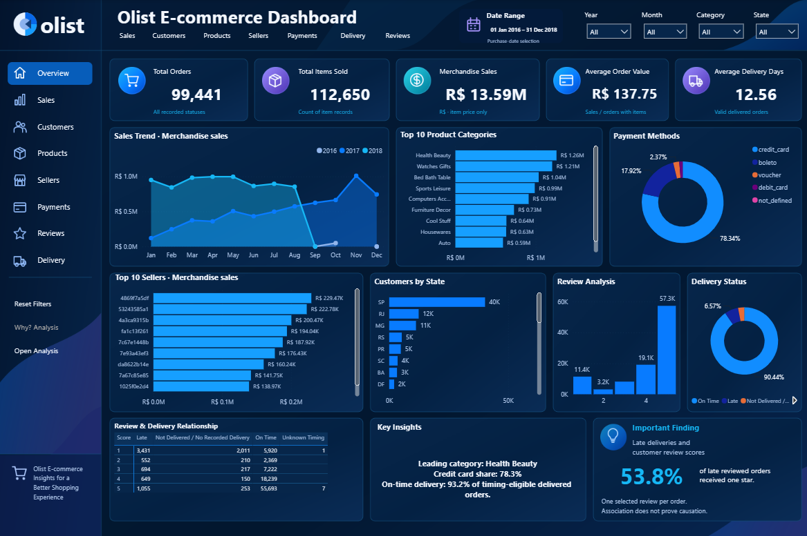
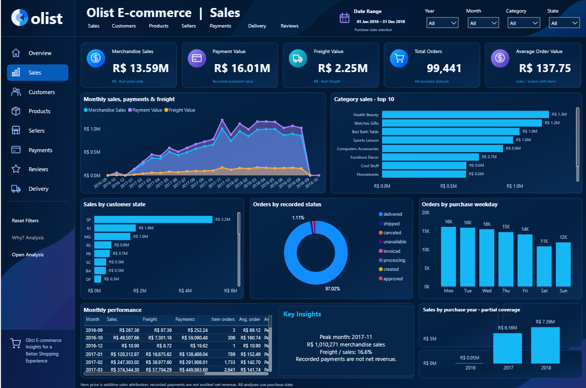
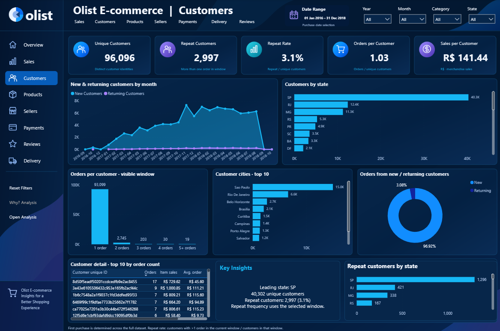
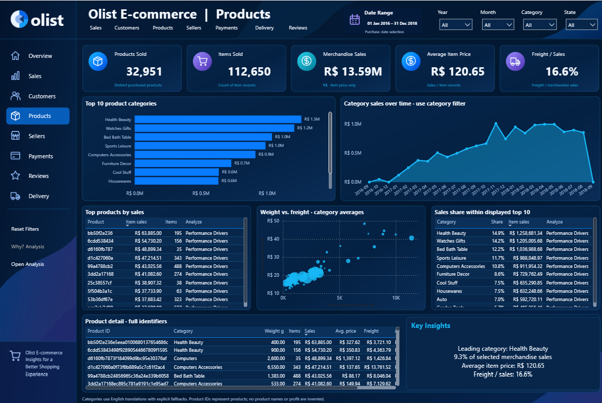
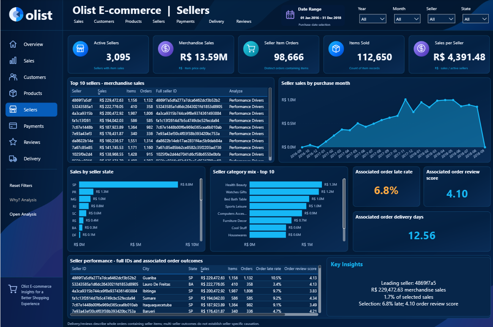
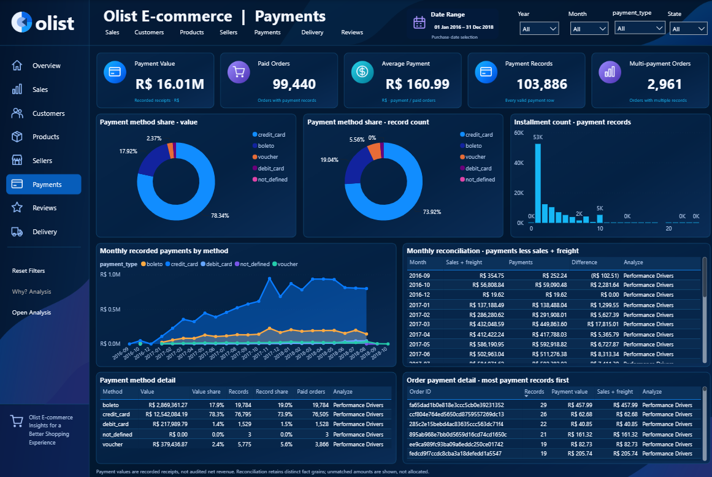
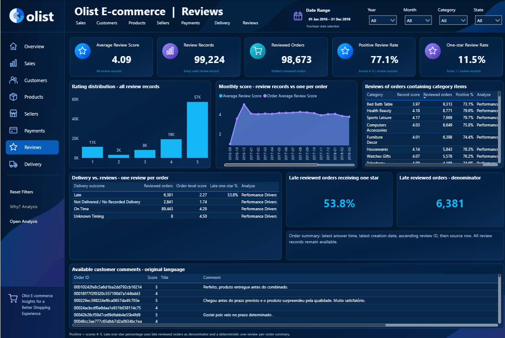
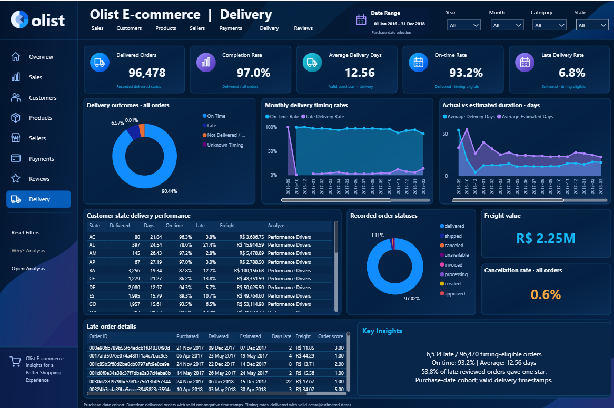
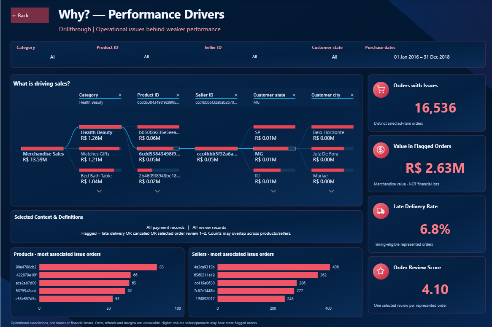

# Olist E-Commerce Data Analysis: SQL Server & Power BI


An end-to-end analysis of the Brazilian **Olist** e-commerce marketplace. Raw CSV files were cleaned and validated in **SQL Server**, explored through business-driven SQL queries, then modeled and visualized in an interactive **Power BI** report with 8 analytical pages and a drill-through "Why?" page.

## Live Dashboard

**[Click here to explore the interactive Olist Dashboard](https://app.powerbi.com/view?r=eyJrIjoiNWIxNmYxNmItMTYxYy00OWMzLWE4YzMtYzBhYzUxYjRmMzEzIiwidCI6IjJiYjZlNWJjLWMxMDktNDdmYi05NDMzLWMxYzZmNGZhMzNmZiIsImMiOjl9)**

The report includes date, year, month, state, category, product, and seller filters, KPI cards, dynamic insight boxes, page navigation, Reset Filters buttons, and a drill-through page powered by a Decomposition Tree.



---

## Table of Contents

- [Project Overview](#project-overview)
- [Business Questions](#business-questions)
- [Tools & Technologies](#tools--technologies)
- [Dataset](#dataset)
- [SQL Analysis](#sql-analysis)
- [Power BI Dashboard](#power-bi-dashboard)
- [Dashboard Screenshots](#dashboard-screenshots)
- [Key Business Insights](#key-business-insights)
- [Recommendations](#recommendations)
- [Limitations & Assumptions](#limitations--assumptions)
- [Repository Structure](#repository-structure)
- [Conclusion](#conclusion)

---

## Project Overview

The goal of this project is to turn raw e-commerce transaction data into a clear picture of business performance: sales, customers, products, sellers, payments, customer satisfaction, and delivery efficiency.

The workflow:

1. **Data exploration:** understand the 9 source tables and their sizes.
2. **Data cleaning:** build staging tables, check duplicates, NULLs, invalid values, and inconsistent dates.
3. **Data validation:** verify relationships between all main business entities.
4. **Exploratory data analysis (EDA):** answer business questions with SQL.
5. **Data modeling:** build a star-style model in Power BI with relationships that avoid double counting.
6. **Dashboard design:** build an 8-page interactive report plus a hidden drill-through page.

---

## Business Questions

- What is the overall sales performance, and how did it change over time?
- Which product categories and sellers generate the most sales?
- Where are the customers concentrated?
- Which payment methods are used the most, and which carry the most value?
- How satisfied are customers, and what is the relationship between delivery delays and review scores?
- How reliable and fast is delivery?
- Which months are the strongest in sales?

---

## Tools & Technologies

| Tool | Usage |
|---|---|
| **SQL Server** | Staging, data cleaning, validation, and exploratory analysis |
| **Power BI** | Data modeling, visualization, interactive reporting |
| **DAX** | 96 explicit measures for business KPIs |
| **Power Query** | Data type conversion and preparation |
| **GitHub** | Documentation and version control |

---

## Dataset

Nine original Olist CSV files:

| Dataset | Description |
|---|---|
| `olist_customers` | Customer IDs, city, state, ZIP prefix |
| `olist_orders` | Order status and key timestamps |
| `olist_order_items` | Products, sellers, prices, and freight per order item |
| `olist_order_payments` | Payment type, value, and installments |
| `olist_order_reviews` | Review scores, comments, and dates |
| `olist_products` | Product category, weight, and dimensions |
| `olist_sellers` | Seller location |
| `olist_geolocation` | ZIP prefix coordinates |
| `product_category_name_translation` | Portuguese to English category names |

Tables were kept at their **original granularity** (one row per order, item, payment record, or review), because an order can contain multiple items, multiple payments, and multiple reviews.

---

## SQL Analysis

The SQL work is split into three scripts, each focused on one stage.

### 1. Data Cleaning (`Data_Cleaning.sql`)

- Counted rows in all 9 tables for an initial overview.
- Created **staging copies** of every table so the raw data stays untouched, and verified that raw and staging row counts match.
- Checked duplicates using the proper key for each table: `customer_id`, `order_id`, `order_id + order_item_id`, `product_id`, `seller_id`, `order_id + payment_sequential`, and `review_id + order_id`.
- Found **exact duplicate rows in the geolocation table** and removed them into a clean table (`olist_geolocation_clean`).
- Standardization checks: city/state formatting, leading and trailing spaces in IDs, ZIP code ranges, and category translation values.
- Checked NULLs, negative values, and invalid ranges in every table.

**Data quality findings (all documented in the script):**

| Finding | Decision |
|---|---|
| 23 orders where the customer delivery date is earlier than the carrier date | Kept unchanged; correct value cannot be determined |
| Orders where the carrier date is earlier than the approval date | Kept unchanged for the same reason |
| 2 products with missing weight and dimensions | Kept unchanged |
| About 610 products with missing descriptive attributes | Kept; not needed for the analysis |
| 2 payment records with `payment_installments = 0` | Kept unchanged |
| NULLs in review comment title/message | Valid; comments are optional |
| Missing latitude/longitude in some geolocation rows | Kept unchanged |
| NULL delivery dates for canceled/unavailable orders | Expected given the order status |

The guiding principle was to **never fix a value using unsupported assumptions**: records were removed only when they were exact duplicates.

### 2. Data Validation (`Data_Validation.sql`)

Validated relationships using `LEFT JOIN ... IS NULL` checks:

- Orders to Customers, Order Items to Orders, Order Items to Products, Order Items to Sellers, Payments to Orders, Reviews to Orders: **no orphan records found**.
- Orders without order items: mainly **unavailable and canceled** orders, consistent with their status.
- Orders without payment records: **one delivered order**, kept unchanged.

### 3. Exploratory Data Analysis (`EDA.sql`)

Business-driven queries covering overall sales, yearly and monthly trends, product categories, sellers, customers by state and city, payment methods (count, average, and total value), review score distribution, reviews by delivery status, and delivery performance by year.

---

## Power BI Dashboard

The report was built in an editable **PBIP** project with a consistent **Deep Navy** theme on a 1536 x 1024 canvas.

### Report Pages

| # | Page | Focus |
|---|---|---|
| 1 | **Overview** | Executive summary: KPIs, monthly sales trend, top categories, payment methods, top sellers, customers by state, review distribution, delivery status, dynamic insights |
| 2 | **Sales** | Sales, payments, freight, and orders over time; MoM and YoY comparison; category and state breakdown; weekday pattern; detailed matrix |
| 3 | **Customers** | Unique and repeat customers, repeat rate, new vs returning, orders and sales per customer, state and city distribution, top customers |
| 4 | **Products** | Products, items sold, average price, category share, weight vs freight analysis, product detail matrix |
| 5 | **Sellers** | Active sellers, sales per seller, ranking, geography, category mix, delivery and review outcomes |
| 6 | **Payments** | Payment value, methods, installments, multi-payment orders, reconciliation between payments and sales plus freight |
| 7 | **Reviews** | Average score, positive and one-star rates, score distribution, trends, comments, delivery vs rating |
| 8 | **Delivery** | Completion rate, on-time vs late, actual vs estimated dates, delivery days, late and undelivered order details |
| 9 | **Why? Performance Analysis** (hidden drill-through) | Decomposition Tree breaking Merchandise Sales down by English Product Category, Product ID, Seller ID, Customer State, and Customer City, with contextual KPIs |

### Data Model

- The model is centered on the **Orders** table, with separate tables for items, payments, and reviews to preserve their original granularity.
- Relationships: `Customers` to `Orders`; `Orders` to `Order Items`, `Order Payments`, and `Order Reviews`; `Products` and `Sellers` to `Order Items`.
- A dedicated **Date dimension (`DimDate`)** linked to the purchase date, with inactive relationships to the actual and estimated delivery dates for delivery analysis.
- **Single-direction filtering** to avoid circular or ambiguous filter paths.
- A `GeoLookup` table aggregated by ZIP prefix, so repeated geolocation rows do not multiply values.
- English category names with a clear fallback when a translation is missing.

### Derived Fields

- `Delivery Days`, `Estimated Delivery Days`, `Days Beyond Estimate`.
- `Delivery Outcome`: On Time, Late, Unknown Timing, or Not Delivered / No Recorded Delivery.
- `Customer Purchase Type` (New vs Returning), calculated across the full history before applying the date filter.
- A deterministic one-review-per-order summary for order-level metrics, while keeping all original review records for record-level analysis.

### DAX Measures (96, organized in folders)

| Area | Examples |
|---|---|
| Orders | Total Orders, Orders with Items, Items Sold, Items per Order |
| Sales | Merchandise Sales, Freight Value, Average Item Price, Freight to Sales Ratio |
| Customers | Unique Customers, Repeat Customer Rate, New vs Returning Customers, Sales per Customer |
| Products & Sellers | Products Sold, Active Sellers, Sales per Active Seller, rank and share measures |
| Payments | Payment Value, Paid Orders, Payment Records, payment method shares |
| Reviews | Average Review Score, Positive Review Rate, One Star Review Rate |
| Delivery | Completion Rate, Average Delivery Days, On Time Rate, Late Delivery Rate, Cancellation Rate |
| Comparison & Context | Sales MoM Change, Sales YoY Change, dynamic selected-context titles |

**Handling product and seller filters:** products and sellers live at the item level, while orders, payments, and reviews live at the order level. Measures use `TREATAS` and `KEEPFILTERS` to pass the selected items' `order_id` values to the order-level tables. As a result, selecting a category, product, or seller gives correct order, payment, review, and delivery results without double counting.

### Metric Definitions

- **Merchandise Sales:** sum of item prices.
- **Freight Value:** shipping charges, kept separate from merchandise sales.
- **Total Order Value:** merchandise sales plus freight.
- **Payment Value:** recorded payment amounts in the source data (not audited net revenue).

---

## Dashboard Screenshots

### 1. Overview
Executive summary of overall performance: key KPIs, monthly sales trend, top categories, payment methods, top sellers, customers by state, review distribution, and delivery status.


### 2. Sales Analysis
Sales over time with MoM and YoY comparison, product categories, geographic distribution, order status, and weekday pattern.



### 3. Customers Analysis
Unique and repeat customers, new vs returning behavior, orders and sales per customer, and customer distribution by state and city.



### 4. Products Analysis
Product sales, category performance, average item price, top products, and the relationship between product weight and freight.



### 5. Sellers Analysis
Active sellers, seller sales, category mix, geography, and the delivery and review outcomes linked to each seller's orders.



### 6. Payments Analysis
Payment values, methods, installments, multi-payment orders, and reconciliation with sales and freight.



### 7. Reviews Analysis
Review scores, positive and one-star rates, trends, comments, and how delivery performance relates to customer satisfaction.



### 8. Delivery Analysis
Delivery duration, on-time and late rates, completion rate, and actual vs estimated delivery dates.



### 9. Performance Analysis (Drill-through)
A hidden drill-through page that explains selected sales performance using a Decomposition Tree and contextual KPI cards.



### 10. Data Model
The analytical data model and the relationships between the main business entities.


---

## Key Business Insights

### Overall Performance

| Metric | Result |
|---|---:|
| Total Orders | 98,666 |
| Merchandise Sales | 13,591,643.70 |
| Freight Value | 2,251,909.54 |
| Total Order Value | 15,843,553.24 |
| Average Delivery Time (carrier handover to customer) | 9.28 days |
| Late Delivery Rate | 7.87% |

*Values are in the dataset's original currency (Brazilian Real, BRL).*

### 1. Sales Growth
- Total order value grew from **7.14M in 2017** to **8.64M in 2018**, an increase of about **21%**, even though 2018 data ends in September and covers fewer months than 2017.
- 2016 (about 57K) represents only the launch period of the dataset.

### 2. Freight Is a Significant Cost for Customers
- Freight adds about **16.6% on top of merchandise sales** (2.25M on 13.59M) and makes up about **14.2% of total order value**.

### 3. Top Categories
- **Health & Beauty** (`beleza_saude`, 1.26M), **Watches & Gifts** (`relogios_presentes`, 1.21M), and **Bed, Bath & Table** (`cama_mesa_banho`, 1.04M) lead product sales.
- The top 5 categories each generated more than **900K**.

### 4. Seller Base Is Not Dominated by One Seller
- The top seller generated about **229K** and the second about **223K**, around 1.7% of merchandise sales each.
- The top 10 sellers range from about 135K to 229K, so sales are spread across many sellers.

### 5. Customers Are Highly Concentrated Geographically
- **São Paulo (SP)** has 41,746 customer records (about **42%** of the total), followed by **Rio de Janeiro** (12,852) and **Minas Gerais** (11,635).
- These three states together account for about **67%** of customer records.
- Within SP state, **São Paulo city alone has 15,540** customers, around 37% of the state.

### 6. Credit Card Dominates Payments
- Credit card represents about **74% of payment records** and about **78% of total payment value** (12.54M).
- Boleto is second (19,784 records, 2.87M, about 18% of value).
- Average payment value: credit card **163.32**, boleto **145.03**, debit card **142.57**, voucher **65.70**.

### 7. Customers Are Mostly Satisfied, but Dissatisfaction Is Significant
- **5-star reviews are the largest group (57,328)**, and 4 and 5 stars together make up about **77%** of all reviews.
- **11,424 one-star reviews** (about 11.5%) show a notable level of dissatisfaction.

### 8. Late Delivery Strongly Associates With Bad Reviews
- Among reviews of **late orders, 46.15% are 1-star** and only 22.22% are 5-star.
- Among **on-time orders, only about 6.6% are 1-star**.
- This is an association, not proof of causation, but the gap is very large.

### 9. Delivery Is Generally Reliable
- **7,827 orders (7.87%)** were delivered late, so most orders arrive within the estimated date.
- Average delivery time rose from **5.75 days (2016)** to **9.58 days (2017)** and improved slightly to **9.06 days (2018)**.

### 10. Seasonality and Peaks
- **November 2017** was the strongest month of 2017 at about **1.18M**, and 2018 months from January to August all stayed above **1M**, peaking in **April 2018** (about 1.16M).
- Across all years, **May, August, and July** have the highest total revenue.

---

## Recommendations

1. **Make on-time delivery the first priority for customer satisfaction.** Late orders are a small share of volume (7.87%) but generate a very high share of 1-star reviews (46%). Monitor late-delivery rate by seller and state, and set more realistic delivery estimates where delays are frequent.
2. **Review freight pricing.** Freight adds about 16.6% to merchandise sales. Test free-shipping thresholds, regional shipping options, or seller-level freight benchmarks, especially for heavy and bulky products.
3. **Reduce dependence on three states.** SP, RJ, and MG hold about two-thirds of customer records. Targeted marketing and logistics partnerships in other states can unlock growth.
4. **Prioritize high-performing categories.** Allocate inventory, promotions, and seller recruitment to Health & Beauty, Watches & Gifts, and Bed, Bath & Table, while tracking the delivery and review quality of each.
5. **Keep supporting installment-based credit card payments.** Credit card drives most of the payment value, and boleto still carries a meaningful share, so both should stay available. Vouchers have a low average value and are better used as targeted promotions.
6. **Use seller scorecards.** Sales are spread across many sellers, so quality control matters. Track each seller's late-delivery rate and average review score, not only sales.
7. **Plan capacity for seasonal peaks.** November 2017 shows a strong peak, so logistics and customer support should be prepared in advance to protect delivery performance when order volume rises.
8. **Fix data quality issues at the source.** Inconsistent delivery timestamps (23 orders), payments with 0 installments, and a delivered order without a payment record should be resolved in the operational system.

---

## Limitations & Assumptions

- **Profit, cost, and margin are not analyzed.** The source data has no cost information.
- **Partial periods:** 2016 and the end of 2018 are incomplete (for example, September 2018 shows only 166.46 and should not be read as a sales collapse). Monthly totals across all years are also affected by 2018 covering only part of the year.
- **Association, not causation:** the link between late delivery and low review scores does not prove that delays alone caused the ratings.
- **Delivery status in SQL:** the SQL late/on-time classification counts orders without a delivery date as not late. The Power BI report separates these as *Not Delivered / No Recorded Delivery*.
- **Customer counts by state** come from customer records (`customer_id`), not deduplicated unique customers. The Power BI report provides unique customer measures.
- Inconsistent records were **kept unchanged** rather than corrected with unsupported assumptions.
- Financial values are in **BRL**.
- The original PBIP project files are not included in this repository. Screenshots and the interactive Power BI Service link are provided instead.

---

## Repository Structure

```text
Olist-Ecommerce-Data-Analysis/
│
├── README.md
│
├── Data/
│   ├── olist_customers_dataset.csv
│   ├── olist_orders_dataset.csv
│   ├── olist_order_items_dataset.csv
│   ├── olist_order_payments_dataset.csv
│   ├── olist_order_reviews_dataset.csv
│   ├── olist_products_dataset.csv
│   ├── olist_sellers_dataset.csv
│   ├── olist_geolocation_dataset.csv
│   └── product_category_name_translation.csv
│
├── SQL/
│   ├── Data_Cleaning.sql
│   ├── Data_Validation.sql
│   └── EDA.sql
│
└── Dashboard_Screenshots/
    ├── Overview.png
    ├── Sales.png
    ├── Customers.png
    ├── Products.png
    ├── Sellers.png
    ├── Payments.png
    ├── Reviews.png
    ├── Delivery.png
    ├── Performance_Analysis.png
    └── Data Modeling.png
```

---

## Conclusion

This project covers the full analytics workflow: raw data was staged, cleaned, and validated in SQL Server, explored through business-focused queries, and turned into a trustworthy Power BI model that avoids double counting across items, payments, and reviews.

The analysis shows a growing marketplace with a healthy, diversified seller base, a strong dependence on credit card payments and on a few states, and one clear operational lever: **delivery reliability**, which is tightly linked to customer satisfaction.

**Technologies:** SQL Server | Power BI | DAX | Power Query | GitHub

**Dashboard:** [Explore the Interactive Olist Dashboard](https://app.powerbi.com/view?r=eyJrIjoiNWIxNmYxNmItMTYxYy00OWMzLWE4YzMtYzBhYzUxYjRmMzEzIiwidCI6IjJiYjZlNWJjLWMxMDktNDdmYi05NDMzLWMxYzZmNGZhMzNmZiIsImMiOjl9)
